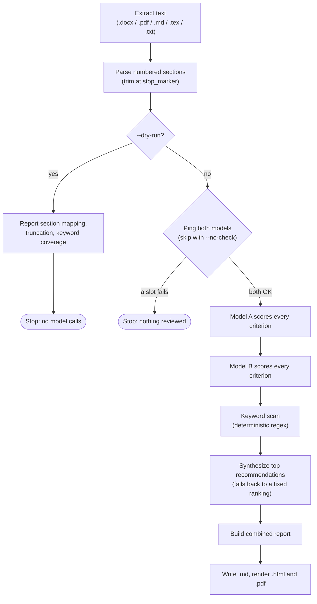

# proposal-reviewer

Config-driven compliance review for grant proposals. Runs a two-model ensemble —
on a local [Ollama](https://ollama.com), on UVA's self-hosted RC GenAI service, or
one of each — plus a deterministic keyword pass against a proposal, scores it
against a rubric defined in a YAML config, and merges everything into a combined
report (`.md` / `.html` / `.pdf`).

No draft ever reaches a commercial provider — the whole point is to review
proposals repeatedly, for free, while you iterate on a draft. Models run either on
your own machine via Ollama or on UVA's self-hosted RC GenAI service; see
[Model backends](#model-backends).

## Why config-driven

The engine (`proposal_reviewer.py`) is proposal-agnostic. Everything specific to a
given funding opportunity — criteria, point caps, section map, keywords, model
picks — lives in a YAML file under `configs/`. One engine, one config per proposal.

## How a review runs

Each criterion sees only its own section (`section: "1.2"`) or the whole document
(`section: "*"`), capped at `max_section_chars`. The per-model and keyword reports
are written as each step finishes; the combined report comes last.

## Setup

Two supported environments. Pick the one you are on — the engine is identical, only
the model backend and the PDF toolchain differ.

### A. Your own machine (macOS, local Ollama)

    brew install ollama pandoc          # pdftotext comes via poppler: brew install poppler
    pip install pyyaml
    ollama pull gemma3:27b              # two DIFFERENT families; both ~27-32B run
    ollama pull qwen2.5:32b             # comfortably on a 64GB machine
    # PDF rendering needs a Unicode-capable engine, one of:
    pip install weasyprint              # or a TeX with xelatex (brew install --cask mactex-no-gui)

Requires Ollama >= 0.19 (MLX backend on Apple Silicon).

### B. UVA HPC (Rivanna / Afton)

No root needed — everything installs into your home directory. Models come from
UVA RC GenAI, from a local Ollama running on a GPU compute node, or one of each.
Do this once:

    # 1. Clone
    git clone git@github.com:dads2busy/proposal-reviewer.git ~/git/proposal-reviewer
    cd ~/git/proposal-reviewer

    # 2. pandoc >= 3. The system pandoc (/usr/bin/pandoc) is 2.0.6 and too old for
    #    TWO independent reasons: it writes setext headings the section parser cannot
    #    see, and its LaTeX output no longer compiles under TeX Live 2025.
    mkdir -p ~/.local/bin
    curl -sSL https://github.com/jgm/pandoc/releases/download/3.1.11/pandoc-3.1.11-linux-amd64.tar.gz \
        | tar xz -C /tmp
    cp /tmp/pandoc-3.1.11/bin/pandoc ~/.local/bin/

    # 3. ~/.local/bin must come BEFORE /usr/bin or you silently get 2.0.6 back
    grep -q '.local/bin' ~/.bashrc || echo 'export PATH=$HOME/.local/bin:$PATH' >> ~/.bashrc
    source ~/.bashrc
    pandoc --version | head -1          # must report 3.x

    # 4. Python dependency (pdftotext is already at /usr/bin/pdftotext)
    pip install --user pyyaml

    # 5. API key for UVA RC GenAI — see .env.example for where to get it
    cp .env.example .env && chmod 600 .env

Then confirm the machine can authenticate:

    python proposal_reviewer.py --config configs/uva-kimi-example.yaml --check-provider

Run this on the machine that will do the review, and rerun it whenever you move
to a different node — reaching the API is a property of the node, not of the key
(see [Model backends](#model-backends)).

#### Local Ollama on HPC (optional)

Ollama runs fine on a GPU compute node with no root. Install the Linux release
archive (`ollama-linux-amd64`, from the
[Ollama releases page](https://github.com/ollama/ollama/releases)) into `~/.local`
so you end up with `~/.local/bin/ollama` and its `~/.local/lib/ollama/` CUDA
libraries — the binary finds them relative to itself. Then pull the models once:

    ollama serve &                      # needed even to pull
    ollama pull gemma3:27b              # 17 GB
    ollama pull qwen2.5:32b             # 24 GB — both land in ~/.ollama

**Nothing starts the server for you.** The engine only calls
`localhost:11434`; it does not launch Ollama. Start `ollama serve &` in every job,
on the compute node, before the review — it dies with the allocation. A
`--check-provider` against a local-Ollama config confirms it came up; forget it and
a full run stops at once with `Ollama is not running`, plus the command to start
it, rather than reviewing anything.

Tested on a V100 (`bii-gpu`, `--gres=gpu:v100:1`). Two things there look alarming
but are fine:

- The serve log says `skipping CUDA device — compute capability not in compiled
  architectures`. That is only the `cuda_v13` build rejecting the V100; it falls
  back to `cuda_v12` and offloads every layer. There is no CUDA problem to fix.
- The two models do not fit in 32 GB of VRAM together. The engine runs one model
  over every criterion before switching, so a run pays one model swap, not one
  per criterion.

#### PDF output on HPC

    module load texlive/2025           # provides xelatex

That is the whole requirement, but it must be loaded in the shell that runs the
review, since rendering happens at the end of the run. Without it you still get
`.md` and `.html`, and the run prints `no PDF engine found`.

**Do not use weasyprint on Rivanna/Afton.** `pip install weasyprint` succeeds and
then every render fails, because RHEL 8's libpango predates a symbol it needs
(`undefined symbol: pango_context_set_round_glyph_positions`). TeX Live is the
working route here.

## Model backends

Model names may carry a provider prefix. A bare name means local Ollama, so
existing configs need no changes.

    models: ["gemma3:27b", "qwen2.5:32b"]            # both local Ollama
    models: ["uva:Kimi K2.5", "ollama:qwen2.5:32b"]  # hybrid

"Local" means the machine running the review — your laptop, or an HPC GPU node
with `ollama serve` running (see [Local Ollama on HPC](#local-ollama-on-hpc-optional)).
A hybrid run needs one node that reaches both, which may rule out a GPU partition
(see below).

Non-local providers are declared in the config and take their key from the
environment — never from the file:

    providers:
      uva:
        kind: openai
        base_url: https://open-webui.rc.virginia.edu/api/
        api_key_env: UVARC_GenAI_API

Copy `.env.example` to `.env` and fill in the key. `.env` is gitignored, and the
engine tightens it to mode 600 on read.

**Being on an HPC node is necessary but not sufficient.** A VPN-connected laptop
returns HTTP 401 even with a valid key, because Apache rejects the request before
the token is ever evaluated — browser access via NetBadge works from anywhere, so
it proves nothing about API access. But an HPC node is no guarantee either: on
2026-09-03 a `bii-gpu` node returned exactly the same Apache 401 while the
service was up and a `standard`-partition run had succeeded the day before. The
tell is that the 401 is byte-identical with a valid key and with no key at all,
and carries no `WWW-Authenticate` header — a rejected *token* would instead come
back as JSON from Open WebUI. So when this fails, do not go editing `.env`.

Which partitions are allowed is not documented here because we have not mapped
it; treat API access as something to check per node, never assume:

    python proposal_reviewer.py --config CONFIG --check-provider

UVA hosts a single model, so a UVA-only config runs the same model twice. The
engine detects this and relabels the combined report: two samples measure whether
a score is *stable*, not whether two independent reviewers agree. It also widens
the second sample's temperature so the extra call is worth making.

See `configs/uva-kimi-example.yaml` for a complete example.

## Use

    # Validate a config against a proposal without running models:
    python proposal_reviewer.py PROPOSAL --config configs/cdc-ip-26-0102.yaml --dry-run

    # Full review:
    python proposal_reviewer.py PROPOSAL --config configs/cdc-ip-26-0102.yaml

    # Override models ad hoc:
    python proposal_reviewer.py PROPOSAL --config CONFIG --models llama3.3:70b qwen3.6:27b

    # Confirm this machine can reach and authenticate against each backend:
    python proposal_reviewer.py --config CONFIG --check-provider

    # Skip the backend check a full run makes before reviewing (see below):
    python proposal_reviewer.py PROPOSAL --config CONFIG --no-check

    # Collect reports somewhere else (useful when the proposal sits on a
    # read-only share, or you want a run history separate from the draft):
    python proposal_reviewer.py PROPOSAL --config CONFIG --outdir ~/reviews/spirale

`PROPOSAL` can be `.docx`, `.pdf`, `.md`, `.tex`, or `.txt`. Reports are written
next to the proposal file unless `--outdir DIR` says otherwise; the directory is
created if missing, and an unusable one is rejected before any model is called
rather than after a full run.

A full run starts by pinging both models — the same check `--check-provider`
makes — and stops if either fails. The engine reviews every criterion with the
first model before the second makes any call, so without this an unreachable
second backend (a stopped `ollama serve`, a node the UVA API refuses) would
surface only after the first model's whole pass. A local model gets up to ten
minutes to answer, since that first call is what loads it. `--dry-run` makes no
model calls and skips the check; `--no-check` skips it on a full run.

## Running a review on HPC, step by step

A full review is ~30 model calls against a long document and takes 15 minutes or
more. That is too long for a login node and too long to trust an SSH connection, so
run it under tmux on a compute node.

**Order matters: tmux on the login node, `ijob` inside it.** Reversed, a dropped
connection kills the job.

    # 1. On the login node, start a named tmux session
    tmux new -s review

    # 2. Inside tmux, claim a compute node. Find your allocation with `allocations`.
    #    UVA backend — no GPU, one core:
    ijob -A <your_allocation> -p standard -c 1 -t 2:00:00
    #    Local Ollama — a GPU node instead:
    ijob -A <your_allocation> -p <gpu_partition> --gres=gpu:v100:1 -c 4 -t 3:00:00

    # With a UVA backend the engine only waits on HTTP, so one core is enough.
    # With local Ollama, 2-4 cores is plenty for a GPU-resident model; more buys
    # nothing (the engine caps Ollama's threads to the cores the job holds).

    # 3. On the compute node, set up the shell
    module load texlive/2025
    cd ~/git/proposal-reviewer
    ollama serve > /tmp/ollama-$USER.log 2>&1 &   # local Ollama only

    # 4. Validate the config against the proposal first — no model calls, seconds
    python proposal_reviewer.py /path/to/PROPOSAL.docx \
        --config configs/arpa-h-igor.yaml --dry-run

    # 5. Confirm THIS node can reach the backend — step 4 does not test that.
    #    Step 6 checks too and stops if a backend fails, but checking here
    #    tells you before you start the long run.
    python proposal_reviewer.py --config configs/arpa-h-igor.yaml --check-provider

    # 6. Run it — UVA backend:
    python proposal_reviewer.py /path/to/PROPOSAL.docx \
        --config configs/arpa-h-igor.yaml \
        --models "uva:Kimi K2.5" "uva:Kimi K2.5"
    #    or local Ollama, two families:
    python proposal_reviewer.py /path/to/PROPOSAL.docx \
        --config configs/arpa-h-igor.yaml \
        --models gemma3:27b qwen2.5:32b

Detach with `Ctrl-b d` and log out; the run continues. Reattach later with:

    tmux attach -t review

Check on it without attaching using `squeue -u $USER` to confirm the job is alive.

Step 4 is not optional in practice. `--dry-run` reports which sections each
criterion actually matched and whether any got truncated, which is where config
mistakes surface — after step 6 you have paid for the whole run to find out.

## Writing a config

See `configs/cdc-ip-26-0102.yaml` (section-targeted scoring) and
`configs/doe-genesis-16a.yaml` (whole-document scoring) for the two patterns, and
`configs/arpa-h-igor.yaml` for a proposal whose outline carries no section numbers.

Each criterion targets a numbered narrative section (e.g. `section: "1.2"`) or the
whole document (`section: "*"`). If the draft's headings aren't numbered, map them
to IDs with `heading_patterns` rather than falling back to `"*"`:

    heading_patterns:
      - {pattern: '^TA1\.\s[A-Z][a-z]', id: "4.1"}

Section text is capped per criterion at `max_section_chars` (default 14000) to stay
inside the model context window, which `num_ctx` sets (default 16384 tokens). Raise
the two together — `--dry-run` flags any section that would be cut and warns when the
cap exceeds what the window can hold. The model awards `0..max` points per criterion;
section subtotals roll up via `section_groups` / `section_totals`. The `keywords`
list is a deterministic regex scan for exact, checkable requirements that models
sometimes gloss (specific platforms, named hubs, required attachments).

## Output

Every run stamps its files with a shared `YYYYMMDD-HHMMSS` suffix (`<ts>`) so
repeated runs don't overwrite each other:

- `compliance_report_<model>_<ts>.md` — one per model
- `compliance_report_keywords_<ts>.md` — deterministic phrase coverage
- `compliance_report_combined_<ts>.md` / `.html` / `.pdf` — merged: synthesized
  top recommendations, per-section scores per model, per-criterion divergence flags,
  gaps where both models converge, shared strengths, and missing-phrase scan

The `.md` and `.html` are always written. The `.pdf` needs a Unicode-capable engine
on PATH — the run tries wkhtmltopdf, weasyprint, then xelatex/lualatex against
several Unicode fonts, and reports `no PDF engine found` rather than failing if none
works. On HPC that means `module load texlive/2025` before the run.

Files land beside the proposal unless `--outdir DIR` says otherwise.
